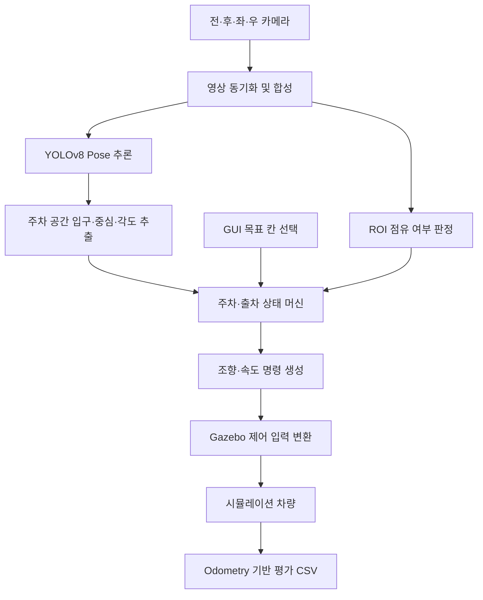

# 서라운드 뷰 기반 자동 주차 시뮬레이션

전·후·좌·우 4개 카메라 영상을 합성한 서라운드 뷰를 이용해 주차 공간을 인식하고, ROS 2와 Gazebo에서 자동 주차·출차를 실험하는 프로젝트입니다. YOLOv8 Pose 모델로 주차 공간의 키포인트를 검출하고, 입구의 위치와 각도를 바탕으로 전진 회전·후진 회전·최종 정렬을 제어합니다.

저장소: [yunss01/surround_view_parking](https://github.com/yunss01/surround_view_parking)

이 문서는 기본 시뮬레이션 실행 구성인 [mission_sim.launch.py](src/simulation_pkg/launch/mission_sim.launch.py)와 현재 소스 코드를 기준으로 작성했습니다. USB 카메라, 어안 렌즈 보정, 시리얼 통신을 사용하는 실차용 보조 코드의 구성도 함께 설명합니다.

## 주요 기능

- 4개 카메라 영상의 시간 동기화 및 서라운드 뷰 합성
- YOLOv8 Pose 기반 주차 공간 탐지와 입구 키포인트 추출
- 주차 공간의 중심·입구 각도 계산 및 프레임 간 방향 연속성 유지
- GUI에서 1~4번 목표 주차 공간 선택, 주차·출차·정지 명령 입력
- 영상 ROI의 밝기 표준편차를 이용한 점유 여부 판정과 인접 장애물에 따른 각도 보정
- 시뮬레이션 최종 위치·방향 오차와 소요 시간을 CSV로 저장
- 카메라 보정 도구, 모델 학습 코드, 실험 결과 분석 스크립트 제공

## 처리 구조



기본 시뮬레이션의 `surroundview_node`는 영상을 회전·크롭·배치하여 합성합니다. 실차용 보조 노드인 `surround_stitching_node`는 `.npy` 좌표 맵으로 영상을 변환하고, 위치·회전·크롭 값을 조절해 합성합니다. 두 방식은 설정 파일과 영상 크기 가정이 다릅니다.

## 폴더와 패키지 구성

```text
surround_view_parking_simulation/
├── src/
│   ├── camera_perception_pkg/     # 카메라 입력, 합성·보정, YOLO, 주차 공간 정보 추출
│   ├── decision_making_pkg/       # 주차·출차 상태 머신 및 모션 명령 생성
│   ├── simulation_pkg/            # Gazebo 실행, 차량·장애물 배치, 제어 입력 변환
│   │   ├── launch/               # mission_sim.launch.py 등
│   │   ├── models/               # 차량·트랙·신호등 모델과 메시·텍스처
│   │   └── worlds/               # track.world 등
│   ├── serial_communication_pkg/  # 실차 모터 제어기용 시리얼 통신
│   ├── interfaces_pkg/            # 인식·주차 공간·제어용 사용자 정의 메시지
│   └── debug_pkg/                 # 영상 시각화, 이미지 저장, 궤적 관련 도구
├── DL model/                      # Pose 모델 학습 코드, 데이터셋, 학습 결과
├── data_analyze/                  # 주차 위치·방향 오차 분석 및 그래프
├── image stdev extract/           # 도로·장애물 영상의 ROI 표준편차 분석
├── npy/                           # 카메라별 remap 좌표 맵
├── best_pose_rev03.pt              # 기본 실행에서 사용하는 주차 공간 Pose 모델
├── fisheye_intrinsics.yaml        # 어안 카메라 내부 파라미터
├── calibration.yaml               # 별도 보정 도구의 투시 변환 설정
├── surround_view_param.yaml       # 맵 기반 합성의 위치·회전·크롭 설정
├── install.sh
└── README.md
```

`build/`, `install/`, `log/`는 빌드 과정에서 생성되며 Git 추적 대상에서 제외됩니다. `npy/`는 카메라 영상의 좌표 변환에 사용하는 맵입니다.

## 실행 환경과 설치

설치 예시는 Ubuntu 22.04, ROS 2 Humble, CPython 3.10을 기준으로 합니다. 저장소의 설치 스크립트가 `ros-humble-*` 패키지를 사용하며, 일부 보조 라이브러리는 `cpython-310.pyc` 파일로 제공됩니다.

| 항목 | 구성 |
| --- | --- |
| ROS·빌드 | ROS 2 Humble, colcon |
| 시뮬레이터 | Gazebo Classic 및 Gazebo ROS 플러그인 |
| 인식 | Ultralytics YOLOv8, PyTorch |
| 영상 처리 | OpenCV, NumPy, `cv_bridge`, `message_filters` |
| GUI | Tkinter, OpenCV 창, rqt를 표시할 수 있는 데스크톱 환경 |
| 보정·실차 통신 | PyYAML, pyserial |
| 데이터 분석 | pandas, matplotlib, seaborn |

### 1. 작업 폴더 준비

기존 로컬 저장소를 사용하는 경우:

```bash
cd /home/sukja/surround_view_parking_simulation
```

새로 내려받는 경우:

```bash
git clone https://github.com/yunss01/surround_view_parking.git surround_view_parking_simulation
cd surround_view_parking_simulation
```

아래 절대 경로는 `/home/sukja/surround_view_parking_simulation`을 기준으로 합니다. 다른 위치에서는 실제 경로로 바꿔야 합니다. 일부 보조 라이브러리가 디렉터리 깊이에 따라 경로를 계산하므로 `/home/<사용자>/<작업폴더>` 형태와 원본 `src/` 구조를 유지하는 것이 현재 코드와 맞습니다.

### 2. 의존성 설치

ROS 2 Humble 설치 후 작업 폴더에서 실행하는 예시입니다.

```bash
source /opt/ros/humble/setup.bash

sudo apt update
sudo apt install -y \
  python3-pip python3-tk python3-colcon-common-extensions python3-rosdep \
  gazebo ros-humble-gazebo-ros-pkgs \
  ros-humble-cv-bridge ros-humble-message-filters \
  ros-humble-rqt ros-humble-rqt-image-view ros-humble-xacro

python3.10 -m pip install \
  setuptools==58.2.0 ultralytics==8.2.69 \
  "numpy<2" opencv-python PyYAML pyserial huggingface_hub
```

`ultralytics`와 `setuptools` 버전은 기존 `install.sh`에 명시된 값입니다. NumPy는 기존 코드와의 호환성을 고려해 2 미만으로 제한한 설치 예시이며, 전체 의존성 버전을 고정하는 파일은 없습니다. GPU 추론에는 사용하는 GPU·CUDA 환경과 맞는 PyTorch 구성이 필요합니다.

`rosdep` 최초 설정이 안 된 환경에서는 한 번만 `sudo rosdep init`을 실행한 뒤 패키지 의존성을 설치합니다.

```bash
rosdep update
rosdep install --from-paths src --ignore-src --rosdistro humble -r -y
```

분석 스크립트를 사용할 때는 추가로 설치합니다.

```bash
python3.10 -m pip install pandas matplotlib seaborn
```

기존 [install.sh](install.sh)는 예전 작업 폴더 `ros2_autonomous_vehicle_simulation`을 참조하고, `.bashrc` 수정과 Gazebo 모델 폴더 복사·일부 삭제를 수행합니다. 현재 경로에서 사용하려면 해당 내용을 먼저 확인하고 경로를 맞춰야 합니다.

### 3. YOLO 모델 경로와 장치 설정

[yolov8_node.py](src/camera_perception_pkg/camera_perception_pkg/yolov8_node.py)의 기본 설정은 다음과 같습니다.

| ROS 파라미터 | 기본값 | 의미 |
| --- | --- | --- |
| `model` | `/home/sukja/surround_view_parking_simulation/best_pose_rev03.pt` | 주차 공간 Pose 모델 |
| `device` | `cuda:0` | 추론 장치 |
| `threshold` | `0.5` | 탐지 신뢰도 임계값 |
| `enable` | `True` | 추론 활성화 여부 |

다른 경로나 CPU 환경에서는 기본 실행 파일의 `yolov8_node`에 파라미터를 지정할 수 있습니다.

```python
Node(
    package='camera_perception_pkg',
    executable='yolov8_node',
    output='screen',
    parameters=[{
        'model': '/home/sukja/surround_view_parking_simulation/best_pose_rev03.pt',
        'device': 'cpu',
    }],
),
```

이 YOLO 노드의 기본 장치는 GPU이며 CPU로 자동 전환하지 않습니다. `config.py`의 `Yolov8Settings.DEVICE`는 별도 설정이므로 이 노드의 파라미터를 직접 지정해야 합니다.

주차 공간 추출기는 클래스 이름이 `parking_spot`인 객체의 키포인트를 사용합니다. 학습 데이터는 객체당 4개 키포인트를 정의하며, 추출기는 첫 두 점을 입구로 사용하고 안쪽 두 점을 설정된 깊이로 재구성합니다. 모델을 교체할 때는 키포인트 순서도 맞아야 합니다.

### 4. 빌드

```bash
source /opt/ros/humble/setup.bash
colcon build --symlink-install
source install/setup.bash
```

소스 폴더의 보조 라이브러리와 리소스를 참조하는 구조이므로 `--symlink-install`을 사용합니다. 패키지 설정이나 사용자 정의 메시지를 변경한 경우 다시 빌드합니다.

## 기본 시뮬레이션 실행

```bash
cd /home/sukja/surround_view_parking_simulation
source /opt/ros/humble/setup.bash
source install/setup.bash

export GAZEBO_MODEL_PATH="/home/sukja/surround_view_parking_simulation/src/simulation_pkg/models${GAZEBO_MODEL_PATH:+:$GAZEBO_MODEL_PATH}"

ros2 launch simulation_pkg mission_sim.launch.py
```

실행 구성은 `track.world`, rqt, 자차·장애물 배치 노드, `surroundview_node`, YOLO, 인식 시각화, 주차 공간 추출기, `sim_parking_planner_node`, 모션 계획 노드, Gazebo 제어 변환 노드를 시작합니다. 현재 장애물 배치 코드는 1번·3번 주차 공간에 차량을 생성하도록 설정되어 있습니다.

GUI 조작 순서는 다음과 같습니다.

1. 카메라와 인식 결과가 들어오는지 확인합니다.
2. `Park at Spot 1`~`Park at Spot 4` 중 목표 칸을 선택해 주차를 시작합니다.
3. 주차 완료 후 `UNPARK / SKIP`으로 출차를 시작합니다. 점유 판정 등으로 실패한 경우에는 해당 칸을 지나가는 동작으로 사용됩니다.
4. 정지 명령은 `EMERGENCY STOP`으로 입력합니다. 전체 실행을 종료하려면 실행 터미널에서 `Ctrl+C`를 누릅니다.

기본 노드는 `READY`에서 GUI 입력을 기다립니다. `install.sh`의 `/go` 서비스 별칭으로 시작하는 흐름이 아닙니다. 실행 파일은 시작 시 `killall gzserver`, `killall gzclient`를 호출하므로 같은 환경의 기존 Gazebo 세션도 종료될 수 있습니다.

## 주차·출차 제어와 설정

구현: [sim_parking_planner_node.py](src/decision_making_pkg/decision_making_pkg/sim_parking_planner_node.py)

| 상태 | 역할 |
| --- | --- |
| `READY` | 목표 주차 공간 선택 대기 |
| `APPROACHING` | 선택한 칸에 해당하는 시간만큼 전진 |
| `SEARCHING` | ROI 점유 여부 확인 및 인식된 주차 공간 선택 |
| `CALCULATING` | 첫 회전의 기준 입구 각도 설정 |
| `ARC_1_SWING` | 전진 회전으로 초기 진입 자세 형성 |
| `ARC_2_REVERSE` | 후진 회전으로 주차 공간과 각도 정렬 |
| `ALIGNMENT` | 후진하여 주차 공간 중심과의 세로 방향 오차 축소 |
| `FINISHED` | 정지 명령 발행 및 평가 데이터 저장 |
| `PARKING_FAILED` | 점유 판정 또는 주차선 인식 실패에 따른 정지 |
| `UNPARKING_EXIT_SPOT` | 주차 공간에서 전진 이탈 |
| `UNPARKING_TURN` | 주행 방향으로 회전 |
| `UNPARKING_DEPARTURE` | 설정된 시간만큼 직진 후 정지 명령 발행 |

다음 값은 시뮬레이션 주차 노드의 코드 내부 설정입니다. ROS 파라미터로 선언되어 있지 않으므로 변경하려면 해당 파일을 수정합니다.

| 항목 | 현재 값 |
| --- | --- |
| 제어 주기 | `0.05`초 |
| 영상 중심 기준 | 850×1150 영상의 중심 `(425, 575)` |
| 최대 조향 명령 `max_steering` | `7.0` |
| 접근 속도 `approach_speed` | `50.0` |
| 1~4번 칸 접근 시간 | `9.5`, `13.7`, `17.7`, `21.7`초 |
| 첫 회전 종료 각도 변화량 `switch_angle_threshold` | `30.0`도 |
| 1~4번 칸 후진 회전 종료 각도 임계값 | `3.5`, `2.6`, `2.0`, `1.8`도; 3회 연속 충족 |
| 최종 정렬 종료 기준 | 주차 공간 중심과 영상 중심의 Y 차이 `< 85`픽셀 |
| 점유 판정 ROI | X: `700~850`, Y: `550~650` |
| 점유 판정 | 최근 5회 밝기 표준편차 평균 `> 20.0` |
| 인접 장애물 판정 시 각도 보정 | `-2.4`도 |
| 1~4번 칸 출차 후 직진 시간 | `18.0`, `14.5`, `10.0`, `6.0`초 |

점유 판정은 지정 ROI의 텍스처를 이용하는 휴리스틱입니다. 영상 크기·카메라 배치·조명·바닥 무늬가 달라지면 ROI와 임계값을 다시 맞춰야 합니다. 목표 칸 번호는 접근 시간과 평가 기준 위치를 선택하는 데 사용되며, 인식 객체에 1~4번의 고정 ID가 부여되는 구조는 아닙니다.

[parking_spot_extractor_node.py](src/camera_perception_pkg/camera_perception_pkg/parking_spot_extractor_node.py)의 재구성 스케일은 `CAR_LENGTH_M=1.0`, `CAR_LENGTH_PX=340.0`, 입구에서 중심까지의 깊이는 `PARKING_DEPTH_M=0.75`입니다. 이 값은 시뮬레이션·실차 영상의 실제 크기에 맞춰 확인해야 합니다.

[motion_planner_node.py](src/decision_making_pkg/decision_making_pkg/motion_planner_node.py)는 주차 명령을 받아 조향을 `-7~7`로 제한하고, 2초 동안 새 명령이 없으면 0 명령을 발행합니다. 속도 `50.0`, `-25.0` 등은 m/s가 아닌 제어 입력입니다. Gazebo 변환에는 [config.py](src/simulation_pkg/simulation_pkg/config.py)의 최대 속도와 조향·진행 방향 부호 설정을 사용합니다. `Config.MODE`는 현재 `driving`이며 실행 파일 이름에 따라 자동 변경되지 않습니다.

## 주요 토픽과 메시지

| 토픽 | 메시지 타입 | 내용 |
| --- | --- | --- |
| `/fo_camera/image_raw` | `sensor_msgs/msg/Image` | 전방 영상; 코드에서 사용하는 이름 그대로 표기 |
| `/rear_camera/image_raw` | `sensor_msgs/msg/Image` | 후방 영상 |
| `/left_camera/image_raw`, `/right_camera/image_raw` | `sensor_msgs/msg/Image` | 좌·우 영상 |
| `/surround_view/image_raw` | `sensor_msgs/msg/Image` | 합성 서라운드 뷰 |
| `/detections` | `interfaces_pkg/msg/DetectionArray` | 탐지 박스와 키포인트 |
| `/yolo_debug_image` | `sensor_msgs/msg/Image` | YOLO가 그린 인식 결과 영상 |
| `/bev_perception_result` | `interfaces_pkg/msg/BevPerceptionResult` | 주차 공간 중심·입구 각도·네 꼭짓점 |
| `/bev_perception_image` | `sensor_msgs/msg/Image` | 주차 공간 재구성 디버깅 영상 |
| `/parking_path` | `interfaces_pkg/msg/PathPlanningResult` | 주차 조향·속도 명령 |
| `/parking_status` | `std_msgs/msg/String` | 상태 머신의 현재 상태 |
| `/topic_control_signal` | `interfaces_pkg/msg/MotionCommand` | 실수형 조향·좌우 속도 명령 |
| `/cmd_vel` | `geometry_msgs/msg/Twist` | Gazebo 차량 제어 입력 |
| `/odom` | `nav_msgs/msg/Odometry` | 평가용 차량 위치·자세 |

`/parking_path`는 이름과 달리 공간 경로 좌표를 보내는 용도로 쓰이지 않습니다. 현재 구현은 `x_points[0]`에 조향값, `y_points[0]`에 속도값을 넣습니다. 주차 공간 메시지의 중심과 꼭짓점은 영상 픽셀 좌표이며, `MotionCommand`의 세 필드는 `float32`입니다.

영상 확인은 `ros2 run rqt_image_view rqt_image_view`에서 `/surround_view/image_raw`, `/yolo_debug_image`, `/bev_perception_image`를 선택하면 됩니다. 별도 터미널의 `ros2 topic echo /parking_status`로 상태를 확인할 수 있습니다.

## 카메라 보정과 실차용 보조 구성

실차용 코드는 USB 카메라와 시리얼 모터 제어기를 사용하는 별도 구성입니다. 아래 절차는 코드에 정의된 연결 방법이며, 문서 작성 과정에서 하드웨어 동작을 검증한 것은 아닙니다.

### 준비할 설정

- [image_publisher_node.py](src/camera_perception_pkg/camera_perception_pkg/image_publisher_node.py): 전·후·좌·우 카메라 장치 번호는 현재 `0`, `4`, `8`, `6`이며 요청 영상 크기는 640×480, MJPG 형식입니다. 실제 연결 순서에 맞춰 수정합니다.
- [surround_stitching_node.py](src/camera_perception_pkg/camera_perception_pkg/surround_stitching_node.py): `load_maps()`의 `map_dir`가 `/home/autolab/surround_view_parking-main/npy`로 고정되어 있으므로 현재 저장소의 `npy/` 절대 경로로 수정합니다.
- [surround_view_param.yaml](surround_view_param.yaml): 카메라별 위치 `x`, `y`, 회전 `r`, 크롭 `ct`, `cb`, `cl`, `cr`을 저장합니다. 스티칭 노드는 현재 작업 디렉터리에서 이 파일을 읽으며 GUI에서 `s`를 누르면 저장합니다.
- [serial_sender_node.py](src/serial_communication_pkg/serial_communication_pkg/serial_sender_node.py): 기본 포트는 `/dev/ttyACM0`, 통신 속도는 `115200`bps입니다. 포트는 코드 내부 값이며 해당 장치와 접근 권한이 필요합니다.

### 노드 실행 순서

각 터미널에서 작업 폴더로 이동하고 ROS 및 `install/setup.bash`를 불러온 뒤, 다음 노드를 별도로 실행합니다. 시뮬레이션용 노드들과 동시에 실행하지 않도록 구성합니다.

```bash
# 1. 카메라 입력
ros2 run camera_perception_pkg image_publisher_node

# 2. 맵 기반 영상 합성
ros2 run camera_perception_pkg surround_stitching_node

# 3. 키포인트 추론: 필요 시 model·device 파라미터 지정
ros2 run camera_perception_pkg yolov8_node

# 4. 주차 공간 정보 추출
ros2 run camera_perception_pkg parking_spot_extractor_node

# 5. 실차용 GUI 주차 계획
ros2 run decision_making_pkg parking_planner_node

# 6. 모션 명령 생성
ros2 run decision_making_pkg motion_planner_node

# 7. 모터 제어기로 전송
ros2 run serial_communication_pkg serial_sender_node
```

위 명령들은 각각 종료할 때까지 실행되는 프로세스입니다. 스티칭 실행 파일의 정확한 이름은 `surround_stitching_node`입니다. 실차용 `parking_planner_node`는 시뮬레이션용과 접근 시간·후진 속도·정렬 임계값이 다르며, 동일한 출차·평가 CSV 기능을 제공하지 않습니다. 시리얼 메시지 형식은 `s<조향>l<왼쪽속도>r<오른쪽속도>\n`입니다.

### 보정 도구와 파일 관계

| 도구 | 용도 |
| --- | --- |
| `ros2 run camera_perception_pkg fisheye_intrinsic_node` | 체커보드 내부 교차점 10×7로 내부 파라미터 계산. Space로 샘플 수집, `s`로 `capture_data.pkl`과 `fisheye_intrinsics.yaml` 저장 |
| `ros2 run camera_perception_pkg OHB_surround --camera front --topic /fo_camera/image_raw` | 네 점을 좌상→우상→우하→좌하 순서로 선택하고 Enter로 확정하여 remap 좌표 맵 생성 |
| `ros2 run camera_perception_pkg run_click_calibration` | 클릭한 네 점으로 투시 변환을 계산해 `calibration.yaml` 저장 |
| `ros2 run camera_perception_pkg surround_calibration_node` | 슬라이더로 왜곡 보정·투시 변환·배치를 조정하고 `calibration.yaml` 저장 |

`OHB_surround`는 코드 내부 `K`, `D` 값을 사용하며 YAML 값을 자동으로 읽지 않습니다. 새 보정 결과를 사용하려면 이 값을 반영해야 합니다. 생성 파일은 실행 디렉터리에 저장되므로 스티칭 노드가 읽는 `npy/` 위치에 맞춥니다. 후방 카메라는 생성 시 `--camera back`을 사용하지만, 스티칭 로더는 `rear_map_x.npy`, `rear_map_y.npy`를 읽으므로 출력 파일명도 맞춰야 합니다.

맵 기반 `surround_stitching_node`는 `calibration.yaml`을 직접 읽지 않습니다. `.npy` 맵과 `surround_view_param.yaml`을 사용하는 흐름과, YAML 기반 보정 도구의 흐름을 구분해 적용합니다.

## 실험 기록과 데이터 분석

기본 시뮬레이션 주차 노드는 `FINISHED`에서 현재 작업 디렉터리의 `parking_evaluation_obstacle4_spot_<번호>.csv`에 기록을 추가합니다. 파일명의 `obstacle4`는 코드에 고정된 이름이며 실제 장애물 배치를 자동 식별한 결과가 아닙니다.

| CSV 필드 | 내용 |
| --- | --- |
| `Date`, `Target_Spot` | 기록 시각, 선택한 칸 번호 |
| `Duration(s)` | 시작부터 평가 기록 시점까지의 시간; 완료 후 대기 시간 포함 |
| `Total_Dist_Err(cm)` | `/odom` 위치와 코드 내부 `IDEAL_POSES`의 평면 거리 오차 |
| `Heading_Err(deg)` | 기준 Yaw와 현재 Yaw의 각도 차이 |
| `Final_X`, `Final_Y`, `Final_Yaw` | 최종 위치와 방향 |

기준 위치는 시뮬레이터 맵에 맞춘 상수입니다. 다른 월드에서는 `IDEAL_POSES`를 함께 수정해야 합니다. `FINISHED` 진입은 픽셀 거리 조건에 따른 제어 종료이며, CSV 저장 자체가 충돌 여부나 허용 오차 통과를 검증하는 것은 아닙니다. GUI 정지 명령도 `FINISHED`로 전환하므로 실험 자료를 해석할 때 해당 실행을 구분해야 합니다.

[sim_parking_planner_node_repeat.py](src/decision_making_pkg/decision_making_pkg/sim_parking_planner_node_repeat.py)는 GUI 없이 자동 시작하는 보조 노드입니다. `TARGET_SPOT_ID` 환경변수로 목표 칸을 지정하며 기본값은 `2`, 자동 시작 타이머는 6초입니다. 기본 실행 파일에는 포함되지 않으므로 사용하려면 GUI 주차 노드를 이 노드로 교체해야 합니다. 주차 완료 후 CSV를 저장하고 노드를 종료하도록 구현되어 있으며, 여러 회차의 차량 초기화·재실행을 자동 관리하는 러너는 아닙니다.

분석 예시는 다음과 같습니다.

```bash
cd /home/sukja/surround_view_parking_simulation/data_analyze
python3.10 4spot_graph_err.py
```

- [4spot_graph_err.py](data_analyze/4spot_graph_err.py): 4개 칸의 위치 오차와 방향 오차 비교
- [4spot_graph_err_obstacle.py](data_analyze/4spot_graph_err_obstacle.py): 장애물 배치 시나리오별 오차 비교
- [total_err_graph_1spot.py](data_analyze/total_err_graph_1spot.py): 단일 시나리오의 주차 결과 시각화
- [텍스처 분석 도구](<image stdev extract/texture_analysis.py>): ROI 표준편차 데이터 분포 분석

각 분석 스크립트는 상대 경로의 CSV를 읽고 그래프를 저장합니다. 새 주행에서 생성한 파일을 분석하려면 스크립트가 읽는 파일명·위치와 맞춰야 합니다. 텍스처 데이터 추출기는 작업 디렉터리의 `dataset/road`, `dataset/obstacle`에서 이미지를 읽습니다.

## Pose 모델 학습

[학습 스크립트](<DL model/train.py>)와 [데이터셋 설정](<DL model/surround view parking.v9i.yolov8/data.yaml>)에 절대 경로가 있으므로 작업 환경에 맞게 수정한 뒤 실행합니다.

```bash
cd "/home/sukja/surround_view_parking_simulation/DL model"
python3.10 train.py
```

현재 학습 설정은 `yolov8m-pose.pt`, 150 epochs, batch 4, 이미지 크기 1280, AdamW, GPU `device=0`입니다. 키포인트 손실 가중치는 `pose=40.0`, `kobj=3.0`이며 결과는 `parking_runs/train_keypoint_focus` 계열 폴더에 저장합니다. 데이터셋 설정은 단일 클래스 `parking_spot`, `kpt_shape: [4, 3]`입니다. 학습 결과를 추론에 사용하려면 YOLO 노드의 `model` 경로를 새 가중치로 지정합니다.

## 실행 시 확인할 사항

| 항목 | 코드 기준 확인 사항 |
| --- | --- |
| 합성 영상이 발행되지 않음 | 4개 카메라 토픽과 타임스탬프 확인. 합성 노드는 네 영상의 동기화를 기다림 |
| 모델·맵 파일을 찾지 못함 | YOLO 모델 절대 경로와 실차용 `map_dir` 확인. YAML 설정은 현재 작업 디렉터리 기준 |
| CUDA 오류 | YOLO `device` 파라미터와 PyTorch GPU 지원 확인; CPU 사용 시 `device: cpu` 지정 |
| 주차 중심·방향이 어긋남 | 합성 크기와 추출기·제어기의 좌표 기준 확인. 기본 합성·제어기는 850×1150, 마스크 크기가 없는 Pose 결과의 추출기 기본 캔버스는 872×1024로 서로 다름 |
| 별도 `/dbg_image` 시각화가 안 나옴 | 기본 시각화 노드는 `camera/active/image_raw`를 구독함. 합성 영상으로 리매핑하거나 YOLO의 `/yolo_debug_image` 사용 |
| 출차 후 다음 주차 동작 | 현재 출차 종료 분기는 목표 번호를 초기화하지만 `READY`로 상태를 바꾸지 않음. 반복 조작 시 상태 전환 로직 확인 필요 |
| Gazebo 모델·메시 오류 | 모델 검색 경로 및 SDF의 메시 URI 확인. Prius SDF에는 저장소에 없는 `meshes/Hybrid.obj` 참조가 남아 있음 |
| `.pyc` 또는 보조 파일 로딩 오류 | CPython 3.10, 원본 디렉터리 구조, `--symlink-install` 빌드 여부 확인 |
| 실차 장치를 열지 못함 | USB 카메라 번호, 시리얼 포트, 장치 접근 권한 확인. 시리얼 포트는 노드 모듈을 읽을 때 열림 |

`surroundview_maker` 같은 다른 합성·튜닝 도구도 포함되어 있지만 기본 실행과 영상 크기·설정이 다릅니다. 일부 `setup.py` 실행 항목은 현재 없는 모듈을 참조하므로, 등록된 모든 명령이 사용 가능한 것은 아닙니다.

이 문서는 소스와 설정을 확인해 작성했으며, 문서 작성 과정에서 의존성 설치, 시뮬레이션·실차 구동, 모델 학습 또는 주차 성공률 측정은 수행하지 않았습니다. 포함된 CSV·그래프·학습 결과는 기존 실험 자료입니다.

## 라이선스와 인용

루트 [LICENSE](LICENSE)는 MIT 라이선스를 명시합니다. 일부 ROS 패키지와 YOLO 관련 소스에는 GPL 계열 고지가 있으며, 데이터셋 설정에는 CC BY 4.0이 명시되어 있으므로 각 구성 요소의 고지를 함께 확인해야 합니다. 저장소에 포함된 인용 정보는 [CITATION.cff](CITATION.cff)에서 확인할 수 있습니다.
